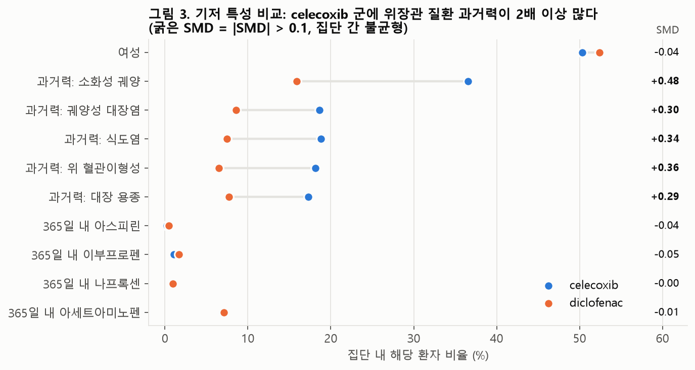
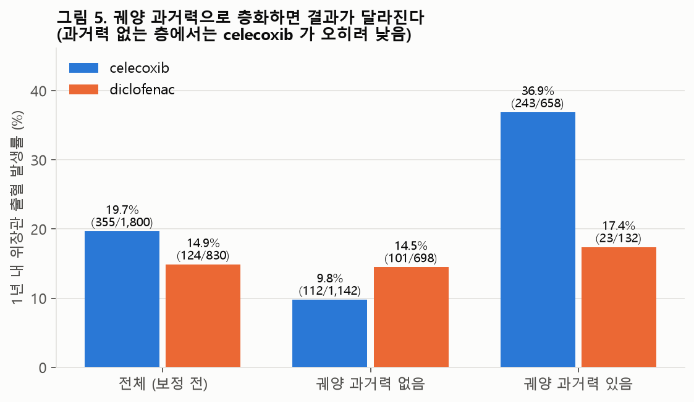
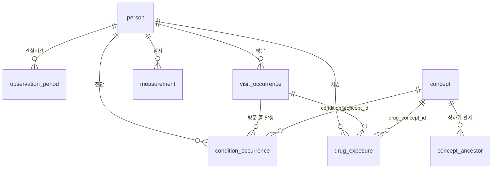
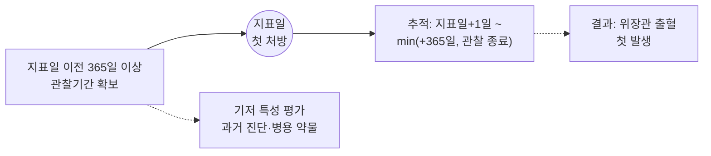
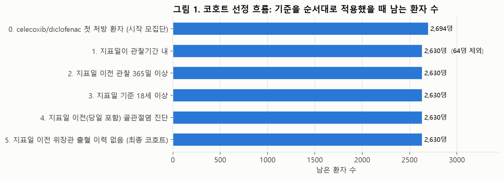
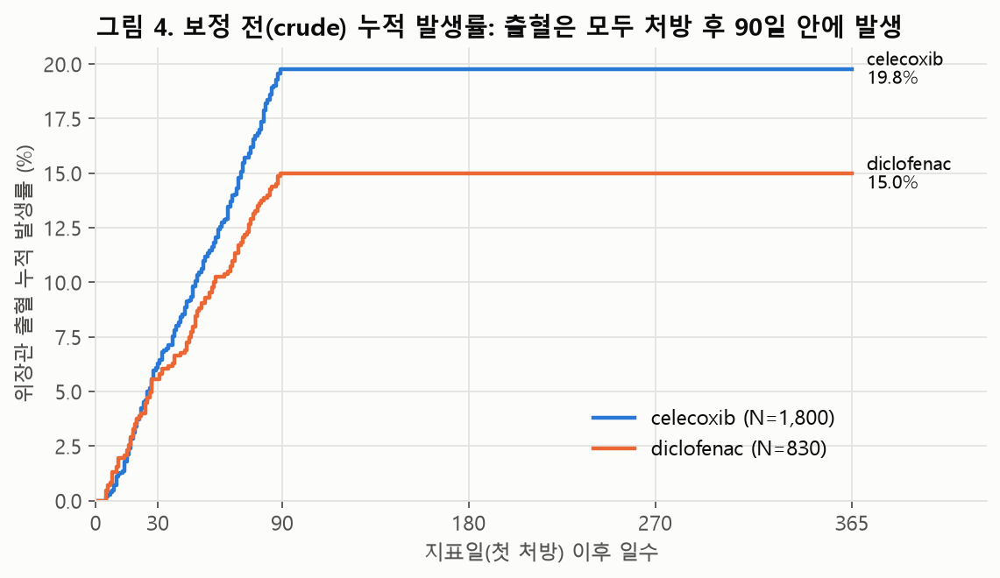

# OMOP-CDM 코호트 분석: NSAID 신규 사용자와 위장관 출혈

OMOP Common Data Model(CDM) 형식의 의료 데이터에서 **SQL로 환자 코호트를 정의·추출하고, 기저 특성과 결과 발생을 분석**한 프로젝트입니다.
실제 병원 EMR 대신 누구나 받을 수 있는 공개 데이터(합성 데이터 Eunomia, 비식별 공개본 MIMIC-IV demo)만 사용했습니다.

| 항목 | 내용 |
|---|---|
| 데이터 | OHDSI **Eunomia GiBleed** (Synthea 합성 환자 2,694명, OMOP CDM v5.3) + 비교용 **MIMIC-IV demo OMOP** (100명) |
| 연구 질문 | 골관절염 환자 중 celecoxib / diclofenac **신규 사용자**의 특성은 어떻게 다르고, 처방 후 위장관 출혈은 얼마나 발생하는가 |
| 도구 | SQL (DuckDB), R (Eunomia, ACHILLES), Python (pandas, matplotlib) |
| 산출물 | 난이도별 SQL 18개, 코호트 선정 흐름표, 기저 특성표(Table 1), 발생률·층화 분석, ACHILLES DB 특성화 |

> **해석 주의** — 이 데이터는 교육용 **합성 데이터**입니다. 아래 수치는 분석 절차를 보여 주기 위한 것이며, 두 약물의 실제 안전성에 대한 근거가 아닙니다.

---

## 1. 핵심 결과 요약

1. **코호트 구축**: celecoxib 또는 diclofenac 첫 처방 환자 2,694명 중, 선정기준을 적용해 **2,630명**(celecoxib 1,800 / diclofenac 830)을 최종 코호트로 확정했습니다. 탈락한 64명은 모두 "지표일이 관찰기간 밖"인 경우였습니다.
2. **보정 전 비교**: 1년 내 위장관 출혈 발생률은 celecoxib 19.7%, diclofenac 14.9%로 celecoxib 쪽이 높게 나왔습니다(위험비 1.32).
3. **그러나 두 집단은 처음부터 달랐습니다**: celecoxib 군은 소화성 궤양 과거력이 36.6%로 diclofenac 군(15.9%)의 2배 이상이었습니다(SMD 0.48). 위장관 위험이 높은 환자에게 celecoxib이 더 많이 처방된 구조입니다.
4. **층화하면 결론이 달라집니다**: 궤양 과거력이 없는 환자만 보면 celecoxib 9.8% vs diclofenac 14.5%로 **방향이 뒤집힙니다**. 과거력이 있는 층에서는 36.9% vs 17.4%입니다.

→ **배운 점**: 보정 전 발생률만 비교하면 틀린 결론에 이를 수 있습니다. 코호트를 뽑은 뒤 기저 특성 균형(SMD)을 먼저 확인하고, 불균형한 변수로 층화·보정해야 합니다. 실제 약물역학에서 "적응증에 의한 교란(confounding by indication)"이라 부르는 문제와 같은 구조입니다.

| 그림 3. 기저 특성 균형 | 그림 5. 층화 발생률 |
|---|---|
|  |  |

---

## 2. 분석 단계와 구현 위치

CDM 기반 코호트 연구의 각 단계와, 이 레포에서 그것을 구현한 위치입니다.

| 분석 단계 | 이 레포에서 한 일 | 위치 |
|---|---|---|
| CDM 구조 이해, 표준 용어(concept) 다루기 | 핵심 테이블 관계 정리, `concept` / `concept_ancestor`로 약물을 성분 단위로 롤업 | [3장](#3-omop-cdm-핵심-테이블-구조), `sql/01_basic/b04` |
| 연구 계획서의 선정·제외기준을 SQL로 구현 | 신규 사용자 설계, 관찰기간·washout·적응증·결과 과거력 기준을 플래그로 구현 | `sql/03_cohort/c01` |
| 코호트 선정 흐름(attrition) 보고 | 단계별 잔존·탈락 인원 표와 그림 | `sql/03_cohort/c02`, 그림 1 |
| 기저 특성표(Table 1) 작성 | 지표일 이전 정보만으로 공변량 생성, SMD로 균형 평가 | `sql/03_cohort/c04`, `src/analyze_cohort.py` |
| 약처방 분석 (노출 기간, 사용 현황) | 처방 기록을 연속 복용 기간(era)으로 병합, 성분×성별×연령 사용 현황 | `sql/04_patterns/p04`, `sql/02_intermediate/i03` |
| 결과 발생률 산출 | 누적 발생률, 인년당 발생 밀도, Kaplan-Meier 곡선 | `sql/03_cohort/c06~c07`, 그림 4 |
| 데이터 품질 점검 | 직접 짠 SQL 점검 8종 + OHDSI ACHILLES 251종 분석 | `sql/02_intermediate/i01`, `R/02_achilles.R` |
| 다기관 공통 분석 (CDM의 목적) | 같은 SQL 파일을 다른 CDM DB(MIMIC-IV demo)에 수정 없이 실행 | `src/compare_mimic_demo.py` |

실제 병원 CDM과 테이블·컬럼 구조가 같으므로, 여기서 작성한 SQL은 스키마 이름과 concept ID만 바꾸면 실제 환경에서도 동작합니다. 다만 실제 데이터는 규모(수백만 명), 결측·오류, 여러 번의 관찰기간, 복잡한 용어 매핑이 더해지므로 실제 환경에 옮길 때는 추가 검증이 필요합니다.

---

## 3. OMOP CDM 핵심 테이블 구조

OMOP CDM은 병원마다 다른 EMR 구조와 코드 체계를 **같은 테이블 구조 + 같은 표준 용어**로 변환해, 한 번 짠 분석 코드를 여러 기관에서 그대로 돌릴 수 있게 하는 표준입니다.

### 3.1 임상 데이터 테이블

| 테이블 | 한 행의 의미 | 주요 컬럼 | 분석에서의 쓰임 |
|---|---|---|---|
| `person` | 환자 1명 | `person_id`, `gender_concept_id`, `year_of_birth`, `race_concept_id` | 인구통계. 모든 테이블이 `person_id`로 연결됨 |
| `observation_period` | 환자의 기록이 온전히 수집된 기간 | `observation_period_start_date`, `observation_period_end_date` | 분모(추적 가능 기간) 정의. 이 기간 밖 사건은 분석에 쓰지 않음 |
| `visit_occurrence` | 방문 1건 (외래·입원·응급) | `visit_concept_id`, `visit_start_date`, `visit_end_date` | 의료 이용, 재입원 |
| `condition_occurrence` | 진단 1건 | `condition_concept_id`, `condition_start_date` | 적응증, 동반질환, 결과(outcome) |
| `drug_exposure` | 처방·투약 1건 | `drug_concept_id`, `drug_exposure_start_date`, `drug_exposure_end_date`, `days_supply`, `quantity` | 약물 노출, 지표일 |
| `procedure_occurrence` | 시술·수술 1건 | `procedure_concept_id`, `procedure_date` | 처치 이력 |
| `measurement` | 검사 결과 1건 | `measurement_concept_id`, `value_as_number`, `unit_concept_id` | 검사 수치(HbA1c, 혈압 등) |
| `observation` | 위 분류에 속하지 않는 임상 사실 | `observation_concept_id`, `value_as_*` | 생활습관, 가족력, 설문 |
| `death` | 사망 | `death_date`, `cause_concept_id` | 사망 결과, 추적 종료 |

### 3.2 파생 테이블과 용어 테이블

| 테이블 | 설명 |
|---|---|
| `drug_era` | 같은 **성분**의 처방을 30일 간격 규칙으로 이어 붙인 연속 복용 기간. ETL 단계에서 미리 계산됨 |
| `condition_era` | 같은 진단 기록을 이어 붙인 이환 기간 |
| `concept` | 모든 표준 코드의 사전. `concept_id`(숫자) ↔ 이름, 용어 체계(SNOMED, RxNorm, LOINC), 분류 |
| `concept_ancestor` | 개념 간 상하위 관계. 성분(조상) → 그 성분을 포함한 모든 제품(자손) |
| `concept_relationship` | 개념 간 관계 (예: 원본 코드 → 표준 코드 "Maps to") |
| `cohort` | 분석자가 만든 코호트 저장 규격: `cohort_definition_id`, `subject_id`, `cohort_start_date`, `cohort_end_date` |

### 3.3 테이블 관계



### 3.4 꼭 알아야 할 설계 원칙 3가지

1. **모든 코드는 `concept_id`(숫자)로 저장**됩니다. `gender_concept_id = 8532`가 여성이고, 사람이 읽을 이름은 `concept` 테이블과 JOIN해서 얻습니다. 원본 병원 코드는 `*_source_value` 컬럼에 그대로 보존됩니다.
2. **도메인별 표준 용어가 정해져 있습니다**: 진단은 SNOMED CT, 약물은 RxNorm, 검사는 LOINC. `concept_id = 0`은 "표준 개념으로 매핑하지 못함"을 뜻합니다.
3. **`observation_period`가 분석의 분모**입니다. 기록이 없는 것이 "사건이 없었다"인지 "관찰하지 못했다"인지 구분하는 기준이기 때문입니다.

### 3.5 v5.3과 v5.4의 차이

Eunomia GiBleed와 MIMIC-IV demo는 모두 **v5.3.1**로 배포됩니다. 현재 권장 버전인 v5.4와의 주요 차이는 다음과 같으며, 이 프로젝트의 쿼리는 두 버전에서 공통인 컬럼만 사용했습니다.

| 구분 | v5.3 | v5.4 |
|---|---|---|
| `visit_occurrence` 입·퇴원 경로 | `admitting_source_concept_id`, `discharge_to_concept_id` | `admitted_from_concept_id`, `discharged_to_concept_id` (이름 변경) |
| `visit_detail` 상위 방문 | `visit_detail_parent_id` | `parent_visit_detail_id` (이름 변경) |
| 신규 테이블 | – | `episode`, `episode_event` (항암 치료 주기 등 질병 에피소드 표현) |
| 신규 컬럼 | – | `procedure_occurrence.procedure_end_date`, `measurement.unit_source_concept_id`, `measurement.measurement_event_id`, `observation.value_source_value`, `location.country_concept_id` 등 |
| `cohort` 테이블 위치 | CDM 스키마 | 결과(results) 스키마로 이동 |
| 삭제 | `attribute_definition` 테이블 | 제거됨 |

---

## 4. 코호트 정의

### 4.1 연구 설계: 신규 사용자 코호트



| 요소 | 정의 | 이유 |
|---|---|---|
| 대상 약물 | celecoxib (`1118084`), diclofenac (`1124300`) 성분과 그 하위 제품 전체 | `concept_ancestor`로 용량·제형이 다른 제품을 빠짐없이 포함 |
| 지표일 | 두 약물 중 하나를 생애 처음 처방받은 날 | 기존 복용자는 부작용을 견딘 사람만 남아 있어 약이 실제보다 안전해 보임 (prevalent user bias) |
| 기준 A | 지표일이 관찰기간 안에 있음 | 관찰기간 밖 사건은 기록의 완전성을 보장할 수 없음 |
| 기준 B | 지표일 이전 관찰 365일 이상 | "신규" 사용자임을 확인하고 기저 특성을 파악할 최소 기간 |
| 기준 C | 지표일 기준 18세 이상 | 성인 대상 연구 |
| 기준 D | 지표일 또는 그 이전 골관절염(`80180`) 진단 | 적응증 확인 |
| 기준 E | 지표일 이전 위장관 출혈(`192671`) 이력 없음 | 새로 발생한 출혈만 세기 위함 |
| 추적 종료 | 지표일+365일과 관찰기간 종료일 중 빠른 날 | 관찰 종료 이후는 중도절단 처리 |
| 결과 | 추적 기간 중 첫 위장관 출혈 (지표일 당일 제외) | 당일 사건은 약의 결과라기보다 처방의 원인일 수 있음 |

### 4.2 선정 흐름



합성 데이터라 기준 B~E에서는 탈락자가 없습니다. 실제 데이터에서는 각 단계에서 상당수가 빠지며, 그 숫자가 코호트의 대표성을 판단하는 근거가 됩니다. 기준을 탈락시키는 대신 **플래그로 붙여 두는 구조**(`c01`)로 짰기 때문에 기준을 바꿔 보는 민감도 분석이 쉽습니다.

### 4.3 기저 특성 (Table 1)

| 특성 | celecoxib (N=1,800) | diclofenac (N=830) | SMD |
|---|---|---|---|
| 지표일 연령, 평균 ± SD | 38.6 ± 3.3 | 38.6 ± 3.3 | 0.02 |
| 여성 | 906 (50.3%) | 435 (52.4%) | −0.04 |
| 과거 진단 종류 수, 평균 ± SD | 9.0 ± 2.6 | 8.4 ± 2.4 | **0.25** |
| 과거력: 소화성 궤양 | 658 (36.6%) | 132 (15.9%) | **0.48** |
| 과거력: 궤양성 대장염 | 335 (18.6%) | 71 (8.6%) | **0.30** |
| 과거력: 식도염 | 339 (18.8%) | 62 (7.5%) | **0.34** |
| 과거력: 위 혈관이형성 | 327 (18.2%) | 54 (6.5%) | **0.36** |
| 과거력: 대장 용종 | 311 (17.3%) | 64 (7.7%) | **0.29** |
| 365일 내 아스피린 | 4 (0.2%) | 4 (0.5%) | −0.04 |
| 365일 내 이부프로펜 | 19 (1.1%) | 14 (1.7%) | −0.05 |
| 365일 내 아세트아미노펜 | 125 (6.9%) | 59 (7.1%) | −0.01 |

SMD(표준화 평균차)는 두 집단의 차이를 표준편차 단위로 나타낸 값으로, 절댓값이 0.1을 넘으면 불균형으로 봅니다. p-value와 달리 표본 크기에 좌우되지 않아 RWE 연구에서 균형 지표로 씁니다.

### 4.4 결과 발생

| 집단 | 환자 수 | 출혈 발생 | 누적 발생률 | 추적 인년 | 1,000인년당 발생 |
|---|---|---|---|---|---|
| celecoxib | 1,800 | 355 | 19.7% | 1,475.7 | 240.6 |
| diclofenac | 830 | 124 | 14.9% | 712.3 | 174.1 |



**층화 분석** (그림 5)

| 층 | celecoxib | diclofenac | 위험비 |
|---|---|---|---|
| 전체 (보정 전) | 19.7% (355/1,800) | 14.9% (124/830) | 1.32 |
| 궤양 과거력 없음 | 9.8% (112/1,142) | 14.5% (101/698) | 0.68 |
| 궤양 과거력 있음 | 36.9% (243/658) | 17.4% (23/132) | 2.12 |

층마다 위험비의 방향이 다릅니다. 이런 경우 하나의 보정 위험비로 요약하는 것은 적절하지 않고, 층별 결과를 따로 보고해야 합니다. 여기서는 변수 하나로만 층화했으므로 다른 교란 요인은 남아 있습니다.

---

## 5. SQL 구성

모든 분석 로직은 `sql/` 폴더의 `.sql` 파일에 있고, 파일 하나가 쿼리 하나입니다. 각 파일 상단에 목적·사용 기법·그렇게 작성한 이유를 주석으로 적었습니다.

### 5.1 난이도별 쿼리

| 파일 | 내용 | 사용 기법 |
|---|---|---|
| **기초** `sql/01_basic/` | | |
| `b01_table_row_counts` | 테이블별 행 수·환자 수 | `UNION ALL`, `COUNT(DISTINCT)` |
| `b02_person_demographics` | 성별 × 출생 연대 분포 | `LEFT JOIN`, `GROUP BY`, `SUM() OVER ()` |
| `b03_top_conditions` | 흔한 진단 상위 20개와 유병률 | `JOIN`, 스칼라 서브쿼리 |
| `b04_drug_ingredient_rollup` | 약물을 성분 단위로 묶어 집계 | 3-테이블 `JOIN`, `concept_ancestor` |
| **중급** `sql/02_intermediate/` | | |
| `i01_data_quality_checks` | 데이터 품질 점검 8종 | `NOT EXISTS`, `LEFT JOIN ... IS NULL`, `FILTER` |
| `i02_patient_summary_avoid_fanout` | 환자당 1행 요약 | CTE, 집계 후 조인 (행 중복 방지) |
| `i03_nsaid_use_by_age_sex` | NSAID 성분별 사용 현황 | 파생 테이블, `IN (서브쿼리)`, `CASE`, `HAVING` |
| **코호트** `sql/03_cohort/` | | |
| `c01_cohort_candidates` | 지표일 결정 + 선정기준 플래그 | 다단계 CTE, `ROW_NUMBER()`, `EXISTS` 상관 서브쿼리 |
| `c02_cohort_attrition` | 단계별 잔존·탈락 인원 | 조건부 집계, `LAG()`, `FIRST_VALUE()` |
| `c03_cohort_table` | OMOP 표준 `cohort` 테이블 생성 | `LEAST`, 날짜 연산 |
| `c04_baseline_characteristics` | 기저 특성 (환자당 1행) | 날짜 윈도우 `JOIN`, `MAX(CASE WHEN)` 피벗 |
| `c05_top_prior_conditions_by_cohort` | 코호트별 과거 진단 Top 10 | `RANK() OVER (PARTITION BY)` |
| `c06_outcome_time_to_event` | 생존분석용 사건·추적 기간 | 범위 조건 `LEFT JOIN`, `COALESCE` |
| `c07_incidence_summary` | 누적 발생률, 인년당 발생 밀도 | CTE 체이닝, `QUANTILE_CONT`, `FILTER` |

### 5.2 의료 데이터에서 자주 쓰는 SQL 패턴 (`sql/04_patterns/`)

| 파일 | 패턴 | 쓰이는 상황 |
|---|---|---|
| `p01_first_last_event_per_patient` | 환자별 최초·최근 사건 (`ROW_NUMBER`) | 발병 시점, 지표일, 마지막 추적일 |
| `p02_conditional_aggregation_pivot` | 조건부 집계로 세로 → 가로 변환 | 연도별·그룹별 지표를 한 번의 스캔으로 |
| `p03_index_date_windows` | 지표일 기준 기간 필터 | 기저 기간 / 추적 기간 변수 생성 |
| `p04_gaps_and_islands_drug_era` | 끊어진 처방을 연속 복용 기간으로 병합 | 복약 지속성, 약물 노출 기간 |
| `p05_lag_time_between_admissions` | 직전 사건과의 간격 (`LAG`) | 30일 재입원, 재처방 간격 |
| `p06_exclusion_anti_join` | 제외기준 적용 3가지 방법 | "이력이 없는 환자" 추출, `NOT IN`의 NULL 문제 |
| `p07_running_total_and_percentiles` | 누적합·이동평균·분위 | 등록 추이, 다빈도 이용자 식별 |

### 5.3 쿼리를 검증한 방법

숫자가 틀려도 SQL은 오류를 내지 않기 때문에, 결과를 확인할 수 있는 장치를 넣었습니다.

- **정답과 비교**: `p04`에서 직접 구현한 연속 복용 기간 로직의 결과(4,304건, 2,130명, 평균 17.39일)가 CDM에 미리 계산된 `drug_era` 테이블과 일치합니다.
- **다른 방법으로 교차 확인**: `p06`에서 `NOT EXISTS`, `LEFT JOIN ... IS NULL`, `EXCEPT` 세 방식의 결과가 모두 1,892명으로 같습니다.
- **외부 도구와 비교**: ACHILLES가 계산한 celecoxib 1,800명, diclofenac 830명(관찰기간 내 처방 환자)이 제 코호트 인원과 일치합니다.
- **자동 점검**: `src/run_sql.py`가 실행할 때마다 "환자 요약 행 수 = 환자 수", "코호트 내 중복 환자 0명", "흐름표 마지막 숫자 = 코호트 인원"을 `assert`로 확인합니다.

---

## 6. 데이터 품질 점검에서 발견한 것

`sql/02_intermediate/i01_data_quality_checks.sql` 결과입니다. 분석 설계에 직접 영향을 준 항목들입니다.

| 점검 | 결과 | 분석에 준 영향 |
|---|---|---|
| `person`에 없는 환자의 `observation_period` | 5,343행 중 2,649행 | `observation_period`를 단독으로 세면 환자 수가 2배로 나옴. 항상 `person`과 조인해서 사용 |
| 방문과 연결되지 않는 처방 | 67,707건 중 67,490건 | `visit_occurrence_id`로 처방과 방문을 연결하는 분석 불가. 날짜 기준으로만 연결 |
| 수치 결과가 없는 검사 | 44,053건 전부 | 검사 수치 기반 변수(예: 신기능)를 공변량으로 쓸 수 없음 |
| `days_supply`가 0인 처방 | 67,707건 중 32,904건 (대상 약물은 전부) | 복용 지속 기간을 알 수 없어 "복용 중" 기준 추적 대신 치료 의도 방식으로 1년 추적 |
| 인종 미매핑 (`concept_id = 0`) | 2,694명 중 451명 | 6명 중 1명꼴로 값이 없어 인종은 비교 변수로 쓰지 않음 |
| 관찰기간 밖 진단 | 65,332건 중 85건 | 지표일이 관찰기간 밖인 64명을 코호트에서 제외 (기준 A) |
| `death` 테이블 | 0행 | 사망을 결과나 경쟁 위험으로 다룰 수 없음 |

### ACHILLES로 본 DB 특성화

OHDSI 공식 특성화 도구 [ACHILLES](https://github.com/OHDSI/Achilles)를 실행해 251종 분석, 39,669행의 요약 결과를 얻었습니다(`R/02_achilles.R`, 결과는 `results/achilles/`).

- `achilles_analysis_summary.csv`: 실행된 분석 목록 (Person, Observation Period, Condition, Drug, Measurement 등 12개 범주)
- `achilles_key_results.csv`: 전체 환자 수, 성별·출생연도 분포, 진단·약물 concept별 환자 수
- `achilles_results_dist.csv`: 관찰기간 길이, 연령 등 연속형 분포

실행 과정에서 Achilles와 DuckDB 드라이버 조합이 결과 적재 단계에서 실패해(`Column ANALYSIS_ID does not exist`), ACHILLES만 같은 데이터의 SQLite 판에서 돌렸습니다.

---

## 7. 다른 CDM 데이터베이스와 비교: MIMIC-IV demo

같은 `.sql` 파일을 실제 중환자실 환자 100명의 공개 데이터(MIMIC-IV demo OMOP)에 수정 없이 실행했습니다 (`src/compare_mimic_demo.py`).

| 지표 | Eunomia GiBleed (합성) | MIMIC-IV demo (실제·비식별) |
|---|---|---|
| 환자 수 | 2,694 | 100 |
| 관찰기간 중앙값 | 20,870일 (약 57년) | 65일 |
| 방문 유형 종류 | 1 (입원만) | 6 |
| 환자당 처방 건수 | 25.1 | 182.3 |
| 환자당 검사 건수 | 16.4 | 3,385.5 |
| 검사 수치값 채움률 | 0% | 85.5% |
| 처방–방문 연결률 | 0.3% | 100% |
| 사망 기록 환자 | 0 | 15 |
| 진단 concept 이름 조인 | 100% | 0% |
| `concept_ancestor` | 있음 | 없음 |

- **구조가 같아도 가능한 분석은 다릅니다.** Eunomia는 평생에 걸친 외래 위주 기록이라 장기 코호트 연구 형태에 맞고, MIMIC은 짧은 입원 기간에 검사·투약이 밀집된 급성기 데이터입니다.
- **MIMIC demo 공개본에는 표준 용어 사전이 들어 있지 않습니다.** `concept` 테이블에 MIMIC 자체 코드만 있어서 concept 이름 조인과 성분 롤업이 되지 않습니다. 실제로 쓰려면 OHDSI Athena에서 용어집을 받아 적재해야 합니다. CDM이 "구조 표준 + 용어 표준" 두 부분으로 이루어져 있다는 점을 확인한 부분입니다.
- MIMIC은 비식별화를 위해 날짜를 2100년대로 옮겼으므로 연도별 추세 분석에는 쓸 수 없습니다.

---

## 8. 재현 방법

```text
omop-cdm-cohort-analysis/
├── R/
│   ├── 01_setup_eunomia.R      # Eunomia로 GiBleed 데이터셋 다운로드 → DuckDB 파일 생성
│   └── 02_achilles.R           # ACHILLES DB 특성화
├── sql/
│   ├── 01_basic/               # 기초 4개
│   ├── 02_intermediate/        # 중급 3개
│   ├── 03_cohort/              # 코호트 정의·특성화·결과 7개
│   └── 04_patterns/            # 의료 데이터 SQL 패턴 7개
├── src/
│   ├── run_sql.py              # 모든 SQL 실행 + 결과 CSV 저장 + 자동 검증
│   ├── analyze_cohort.py       # Table 1, SMD, Kaplan-Meier, 층화 분석, 그림 5개
│   └── compare_mimic_demo.py   # MIMIC-IV demo와 비교
├── results/
│   ├── tables/                 # 쿼리 결과 CSV
│   ├── figures/                # 그림
│   └── achilles/               # ACHILLES 결과
└── docs/interview_notes.md     # 설계 결정 정리
```

**필요 환경**: R 4.x, Java 17 (Eunomia·ACHILLES가 사용), Python 3.10+

```bash
# 1) R 패키지 설치 (최초 1회)
Rscript -e "install.packages(c('Eunomia','DBI','duckdb','RSQLite','Achilles','DatabaseConnector'))"

# 2) 데이터 준비: GiBleed 다운로드 → data/eunomia_gibleed.duckdb
Rscript R/01_setup_eunomia.R

# 3) 파이썬 패키지 설치 후 분석 실행
pip install -r requirements.txt
python src/run_sql.py            # SQL 18개 실행, results/tables/ 저장
python src/analyze_cohort.py     # Table 1, 그림 생성
python src/compare_mimic_demo.py # (선택) MIMIC-IV demo 자동 다운로드 후 비교

# 4) (선택) ACHILLES
Rscript R/02_achilles.R
```

SQL은 DuckDB 문법으로 작성했습니다. PostgreSQL과 거의 같지만 `DATEDIFF('day', a, b)`, `QUANTILE_CONT`, `FILTER (WHERE ...)` 등 일부는 DBMS에 따라 바꿔야 합니다. OHDSI에서는 이 차이를 SqlRender로 자동 변환합니다.

---

## 9. 한계와 다음 단계

**한계**
- **합성 데이터**: Synthea가 규칙에 따라 생성한 환자이므로 임상적 결론을 낼 수 없습니다. 선정기준 대부분에서 탈락자가 없고, 출혈이 모두 처방 후 5~89일에 발생하는 등 실제보다 단순합니다.
- **교란 보정 미흡**: 변수 하나로 층화한 것이 전부입니다. 측정되지 않은 교란과 다른 공변량의 영향은 남아 있습니다.
- **노출 기간 정보 없음**: `days_supply`가 0이라 실제 복용 기간을 알 수 없어, 약을 중단했거나 바꾼 경우를 반영하지 못했습니다.
- **개념 집합이 단순함**: 결과를 concept 하나(`192671`)로만 정의했습니다. 실제 연구에서는 하위 개념을 포함한 개념 집합을 임상가와 함께 정의하고 검증합니다.
- **규모**: 2,694명이라 쿼리 성능(인덱스, 파티셔닝, 실행 계획)을 고민할 일이 없었습니다.

**다음 단계**
- 성향점수(propensity score) 매칭 또는 가중치로 여러 공변량을 동시에 보정하고, 보정 전후 SMD 비교
- Cox 비례위험 모형으로 위험비와 신뢰구간 추정
- 같은 코호트를 OHDSI ATLAS / CohortMethod로 정의해 직접 짠 SQL과 결과 비교
- MIMIC-IV demo에 Athena 표준 용어집을 적재해 약물 성분 롤업까지 동일하게 실행
- DataQualityDashboard로 데이터 품질 점검 확장

---

## 데이터 출처와 라이선스

- **Eunomia GiBleed**: OHDSI, [Eunomia](https://github.com/OHDSI/Eunomia) / [EunomiaDatasets](https://github.com/OHDSI/EunomiaDatasets). Synthea로 생성한 합성 데이터 (Apache License 2.0)
- **MIMIC-IV demo data in the OMOP Common Data Model v0.9**: PhysioNet, https://physionet.org/content/mimic-iv-demo-omop/0.9/ (크레덴셜 없이 공개. Open Database License, ODbL)
- **OMOP CDM 명세**: https://ohdsi.github.io/CommonDataModel/

데이터 파일은 이 저장소에 포함하지 않으며, 위 스크립트가 원 배포처에서 직접 내려받습니다.
